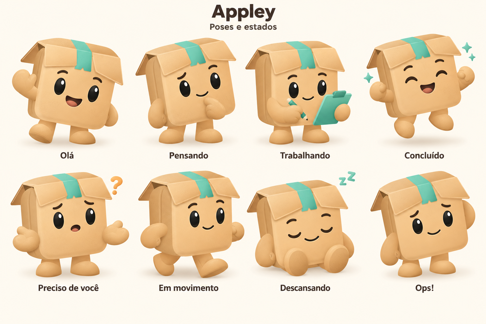

<div align="center">


# Appley

### Seu companheiro de operações no e-commerce.

Um agente pessoal para acompanhar fornecedores, pedidos e pendências — e ajudar você a decidir o próximo passo.

**USO PESSOAL** · **ESCOPO EM DEFINIÇÃO** · **IDENTIDADE EM EXPLORAÇÃO**

[Conheça o Appley](#uma-caixa-viva-com-uma-função-clara) · [Defina o produto](docs/product/escopo.md) · [Explore a pesquisa](docs/research/00-indice.md)

</div>

---

## Uma caixa viva, com uma função clara

O **Appley** combina agentes, automações e integrações para ajudar seu proprietário a gerir uma operação de comércio eletrônico. A proposta é reunir contexto sobre fornecedores e vendas, investigar ocorrências e apresentar decisões com informações verificáveis.

Sua identidade nasce de uma **caixa viva**: papelão claro, fita verde-menta, olhos expressivos e formas arredondadas. É um companheiro que pode demonstrar quando está trabalhando, quando concluiu uma tarefa e quando precisa de você.

O projeto começou como **SupplyOS**, passou pelo nome **Suppley** e agora se apresenta como **Appley**. A origem e as decisões continuam registradas no [contexto](docs/contexto.md) e no [histórico de decisões](docs/product/decisoes.md).

> **Fase atual:** definição do produto e exploração visual. O repositório contém documentação, pesquisa e referências do mascote. As capacidades operacionais abaixo ainda precisam ser especificadas e implementadas.

## O que o Appley poderá acompanhar

| Na sua operação | Como o agente poderá ajudar |
| --- | --- |
| Pedidos e pendências | Mostrar o que aconteceu, o que falta e o que exige atenção |
| Fornecedores e catálogo | Consultar disponibilidade, custo, variante e prazo |
| Margem por venda | Reunir os custos e calcular o resultado estimado |
| Mudanças e imprevistos | Investigar a ocorrência e apresentar opções com evidências |
| Atendimento | Preparar respostas contextualizadas nos canais disponíveis |
| Decisões e execução | Agir dentro dos limites definidos e solicitar sua participação quando necessário |

O primeiro fluxo, marketplace, fornecedor e nível de autonomia serão escolhidos no [escopo de produto](docs/product/escopo.md).

## Um personagem que comunica o estado da operação



| Referência | Uso proposto na interface |
| --- | --- |
| **Olá** | Boas-vindas e apresentação |
| **Pensando** | Análise de informações e investigação |
| **Trabalhando** | Execução de uma tarefa |
| **Concluído** | Resultado confirmado |
| **Preciso de você** | Decisão, autorização ou informação pendente |
| **Em movimento** | Progresso de uma tarefa com várias etapas |
| **Descansando** | Nenhuma tarefa ativa |
| **Ops!** | Falha que precisa de correção ou nova tentativa |

Esses usos são propostas para a interface. O estado exibido deverá acompanhar o que realmente aconteceu na operação e vir com uma descrição clara.

A pose principal já tem uma [versão SVG editável](docs/assets/appley-caixa-viva.svg), com elementos separados para facilitar futuras animações. A prancha de poses é uma referência em PNG; sua adaptação para SVG ainda será feita. Veja as [diretrizes de identidade](docs/design/identidade.md).

## Como transformar a ideia em produto

A proposta combina um agente supervisor, ferramentas específicas e rotinas de automação. O agente interpreta o contexto e investiga exceções; as ferramentas validam dados, valores e autorizações antes de executar ações. O resultado é confirmado na fonte e registrado no histórico.

A intenção de comprar do fornecedor após uma venda orienta a descoberta do produto. Disponibilidade, origem do envio, prazo e pagamento precisam ser confirmados no fluxo escolhido.

**Modelo, linguagem, framework, infraestrutura e banco de dados seguem em definição.** A pesquisa serve de base para essas escolhas.

## Comece por aqui

| Documento | Para quê |
| --- | --- |
| [Escopo de produto](docs/product/escopo.md) | Escolher a primeira versão e seus critérios de aceitação |
| [Cenários de operação](docs/product/cenarios.md) | Descrever situações reais e o comportamento esperado |
| [Contexto e origem](docs/contexto.md) | Entender a evolução da ideia |
| [Decisões](docs/product/decisoes.md) | Consultar escolhas aceitas e propostas em avaliação |
| [Identidade visual](docs/design/identidade.md) | Manter a aparência e o significado dos estados do Appley |
| [Diretrizes](docs/diretrizes.md) | Construir ferramentas, estado, autonomia e integrações |
| [Orientações para agentes](AGENTS.md) | Trabalhar neste repositório |

## Pesquisa que sustenta a construção

Sínteses em português reunidas em **10 de outubro de 2026**, com links às fontes oficiais e limitações identificadas.

| Agentes | Marketplaces |
| --- | --- |
| [Anthropic: arquitetura, ferramentas e avaliação](docs/research/01-anthropic-agentes.md) | [Mercado Livre](docs/research/03-mercado-livre.md) |
| [OpenAI: ferramentas, SDK e observabilidade](docs/research/02-openai-agentes.md) | [Shopee](docs/research/04-shopee.md) |
| | [AliExpress](docs/research/05-aliexpress.md) |
| | [Amazon](docs/research/06-amazon.md) |

Consulte o [índice da pesquisa](docs/research/00-indice.md) para fontes e ressalvas. Políticas e requisitos de integração devem ser revalidados antes de uso em produção.

## Próximos passos

- [x] Registrar contexto, diretrizes e pesquisa oficial.
- [x] Escolher a Caixa Viva como direção do mascote.
- [x] Criar uma pose principal em SVG e referências de novos estados.
- [ ] Fechar o escopo da primeira versão.
- [ ] Confirmar fornecedor, dados e integração do primeiro fluxo.
- [ ] Definir como o proprietário acompanha tarefas e toma decisões.
- [ ] Adaptar os estados selecionados para SVG e animação.
- [ ] Escolher a arquitetura e implementar o primeiro fluxo completo.

## Organização do repositório

```text
.
├── README.md                  # Apresentação do Appley
├── AGENTS.md                  # Orientações de trabalho
└── docs/
    ├── assets/                # Mascote, poses e histórico visual
    ├── design/                # Identidade e uso dos estados
    ├── contexto.md            # Origem e evolução do projeto
    ├── diretrizes.md          # Princípios de construção e operação
    ├── product/               # Escopo, decisões e cenários
    └── research/              # Pesquisa com fontes oficiais
```

<div align="center">

**Appley** · contexto para decidir, companhia para operar.

</div>
