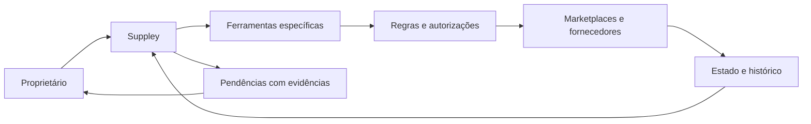

<div align="center">


**Um agente pessoal para acompanhar fornecedores, pedidos e decisões de uma operação de e-commerce.**

`USO PESSOAL` · `PRODUTO EM DEFINIÇÃO` · `PESQUISA DOCUMENTADA`

[Visão e contexto](docs/contexto.md) · [Escopo de produto](docs/product/escopo.md) · [Diretrizes](docs/diretrizes.md) · [Pesquisa](docs/research/00-indice.md)

</div>

---

## A ideia

O **Suppley** nasce para ajudar seu proprietário a gerir uma operação de comércio eletrônico com agentes e automações. Ele deverá reunir informações, acompanhar pedidos, investigar problemas com fornecedores e apoiar decisões sobre catálogo, margem e atendimento.

A ideia de comprar do fornecedor depois de receber uma venda orienta a descoberta do produto. Disponibilidade, origem do envio, prazo, pagamento e responsabilidade perante o comprador precisam ser confirmados para cada operação.

O projeto evoluiu da proposta inicial **SupplyOS** para um agente pessoal chamado **Suppley**. Este repositório, identificado como `appley`, reúne a base para definir seu escopo e desenvolver o produto.

> **Momento atual:** documentação e definição de produto. Há contexto, pesquisa e propostas de funcionamento; a aplicação, as integrações e a autonomia operacional ainda serão especificadas.

## O que queremos resolver

| Pergunta da operação | Capacidade a explorar |
| --- | --- |
| O que vendi e o que está pendente? | Acompanhar pedidos e destacar ocorrências |
| Consigo entregar o produto anunciado? | Verificar disponibilidade, identidade do item e prazo |
| Quanto sobra nesta venda? | Calcular margem com custos verificáveis |
| O que mudou no fornecedor? | Investigar alterações e propor uma resposta |
| O que depende de uma decisão minha? | Mostrar pendências com contexto e evidências |

Essas capacidades são candidatas ao escopo. O primeiro marketplace, fornecedor, catálogo e critérios de sucesso serão definidos em [escopo de produto](docs/product/escopo.md).

## Como o Suppley poderá funcionar



A proposta inicial combina um supervisor, ferramentas específicas e rotinas previsíveis. O agente interpreta situações e investiga exceções; a aplicação confere valores, limites e permissões antes de executar ações. Os resultados são confirmados na fonte e registrados.

**Implementação, modelo, framework, infraestrutura e banco de dados permanecem em aberto.** As recomendações da pesquisa servem para avaliar essas escolhas.

## Comece por aqui

| Documento | O que você encontrará |
| --- | --- |
| [Contexto](docs/contexto.md) | Origem da ideia, mudança de direção e intenção do proprietário |
| [Decisões](docs/product/decisoes.md) | O que foi aceito, o que é proposta e o que falta decidir |
| [Escopo](docs/product/escopo.md) | Documento de trabalho para definir a primeira versão |
| [Cenários](docs/product/cenarios.md) | Situações concretas para especificar o comportamento do produto |
| [Diretrizes](docs/diretrizes.md) | Princípios para ferramentas, estado, autonomia e integrações |
| [AGENTS.md](AGENTS.md) | Instruções para agentes que trabalharem neste repositório |

## Biblioteca de pesquisa

Material reunido em **10 de outubro de 2026**, com sínteses em português e links às fontes oficiais.

| Tema | Referência |
| --- | --- |
| Anthropic | [Arquitetura, ferramentas, contexto e avaliação](docs/research/01-anthropic-agentes.md) |
| OpenAI | [SDK, ferramentas, aprovações e observabilidade](docs/research/02-openai-agentes.md) |
| Mercado Livre | [Pedidos, autorização, mensagens e testes](docs/research/03-mercado-livre.md) |
| Shopee | [Anúncios, dados de compradores e acesso à API](docs/research/04-shopee.md) |
| AliExpress | [Business Program, sourcing e condições de integração](docs/research/05-aliexpress.md) |
| Amazon | [SP-API, mensagens, dropshipping e logística](docs/research/06-amazon.md) |

Os arquivos são sínteses de pesquisa, com limitações identificadas. Políticas, disponibilidade de APIs e requisitos por conta ou região devem ser revalidados antes de uma integração. Veja o [índice da pesquisa](docs/research/00-indice.md).

## Próximos marcos

- [x] Registrar contexto e decisões da conversa.
- [x] Organizar diretrizes e pesquisa oficial.
- [ ] Definir o escopo da primeira versão e seus critérios de aceitação.
- [ ] Confirmar dados, fornecedor e integração do primeiro fluxo.
- [ ] Escolher a arquitetura e implementar uma operação completa.
- [ ] Verificar resultados e ampliar a autonomia conforme as evidências.

## Estrutura do repositório

```text
.
├── README.md                  # Apresentação e navegação
├── AGENTS.md                  # Orientações de trabalho
└── docs/
    ├── assets/                # Elementos visuais da documentação
    ├── contexto.md            # Histórico e intenção do produto
    ├── diretrizes.md          # Princípios de construção e operação
    ├── product/               # Escopo, decisões e cenários
    └── research/              # Acervo de pesquisa com fontes oficiais
```

<div align="center">

**Suppley** · decisões com contexto, execução verificável.

</div>
